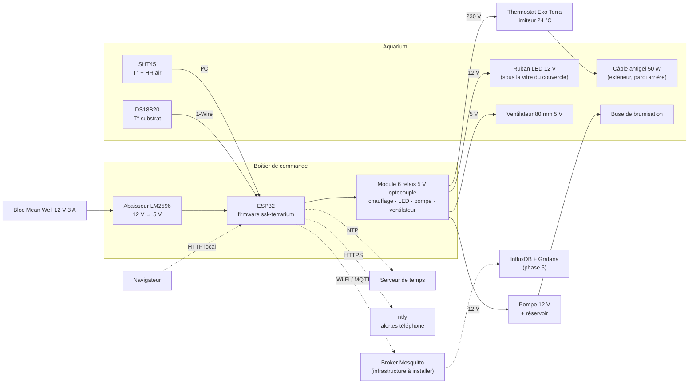

## Objectif

Une centaine de petits-gris vivent dans un aquarium de 96 × 56 × 40 cm, installé dans un garage où il fait 10-12 °C l'hiver — une zone intermédiaire à éviter : il faut choisir entre une hibernation franche et une activité chauffée. Aujourd'hui rien ne tient la température, l'humidité ni la lumière du bac, et rien ne prévient quand elles dérivent. L'élevage est décrit côté données dans [`sskorupski/skarden`](https://github.com/sskorupski/skarden) : [l'installation](https://github.com/sskorupski/skarden/blob/main/installations/aquarium-garage.md) et [l'espèce](https://github.com/sskorupski/skarden/blob/main/animaux/petit-gris.md).

Ce qu'on cherche à obtenir, avec son critère de réussite :

| # | Objectif | Critère de réussite |
| --- | --- | --- |
| O1 | Maintenir la température de l'air | 18-20 °C en mode actif, ±0,5 °C autour de la consigne |
| O2 | Maintenir l'hygrométrie | 75-90 % HR en mode actif |
| O3 | Gérer la photopériode | Plage d'éclairage configurable (12 à 16 h) |
| O4 | Gérer l'hibernation | Mode dédié : hors-gel uniquement (5-8 °C), pas de brumisation, pas de lumière |
| O5 | Superviser à distance | Mesures consultables, historique, alertes sur téléphone |
| O6 | Ne jamais mettre l'élevage en danger | Aucune panne logicielle ou réseau ne peut provoquer une surchauffe |

O6 prime sur tous les autres : un régulateur qui chauffe trop tue l'élevage plus sûrement qu'un régulateur qui ne fait rien.

Ce cadrage réalise O1, O4 et O6. O2, O3 et O5 restent des objectifs du produit : les cadrages des phases suivantes les réaliseront.

Ce cadrage est le premier du référentiel : aucune règle, aucune décision, aucun cadrage ne le précédait — le référentiel a été consulté vide. Il part du document de cadrage v0.1 du 28/10/2026, révisé le même jour sur le matériel : un module de relais électromécaniques remplace les relais statiques et le MOSFET, un ventilateur s'ajoute, l'horloge RTC disparaît au profit de l'heure NTP seule, et l'éclairage devient un ruban LED 12 V.

**Son périmètre : le socle et les phases 0 et 1 de la feuille de route.** Le socle, ce sont les choix d'architecture et le matériel ; la phase 0, le firmware qui compile ; la phase 1, le prototype utilisable cet hiver — mesures, chauffage, hors-gel, modes et sécurité. Il se livre avec la phase 1. Les phases 2 à 5 sont des pistes de ce dépôt, une par fonctionnalité, rangées par jalon ; chacune sera réalisée par le cadrage de sa phase, qui modifiera au besoin les règles posées ici. La vision, les objectifs, l'architecture cible et la feuille de route complète restent ci-dessous comme contexte.

## Parcours utilisateur

Le parcours de la phase 1, sans réseau ni interface : les phases suivantes y ajouteront l'éclairage, la ventilation, la brumisation, la page web, MQTT et les alertes.

1. Avant tout raccordement du 230 V, je câble le boîtier, je vérifie au multimètre que chaque relais reste ouvert carte en reset, au boot et sans firmware, et je pose le limiteur Exo Terra à 24 °C en série du câble antigel.
2. Au premier démarrage, le régulateur part en `MAINTENANCE`, tout coupé. Je choisis le mode par la liaison série USB.
3. En mode `ACTIF`, il tient l'air autour de 19 °C. En novembre, je passe en `HIBERNATION` : le chauffage ne protège plus que du gel. Pour nettoyer le bac, je passe en `MAINTENANCE` : tout est coupé, les mesures continuent.
4. Une coupure de courant survient : au retour, le régulateur repart sorties coupées, reprend le mode dans lequel il tournait, et la régulation du chauffage — le Wi-Fi n'y joue aucun rôle.
5. Quand ça se passe mal — un capteur se tait, le firmware se bloque, le relais de chauffage reste collé, le chauffage tourne sans fin —, le chauffage et la pompe se coupent ou le limiteur matériel coupe à leur place, et la LED d'état le signale.

## Exigences

Chaque exigence porte la phase qui la réalise. Ce cadrage réalise celles des phases 0 et 1 ; les autres sont portées par les pistes des phases suivantes.

### Fonctionnelles

- **F1** Mesurer température et humidité de l'air toutes les 30 s. *(phase 1)*
- **F2** Mesurer la température du substrat côté chaud (sonde optionnelle). *(phase 1)*
- **F3** Réguler le chauffage par hystérésis autour d'une consigne (défaut : 19 °C, hystérésis ±0,5 °C). *(phase 1)*
- **F4** Déclencher la brumisation par impulsions (défaut : 8 s) sous un seuil d'humidité (défaut : 75 %), avec un délai minimal entre deux impulsions (défaut : 10 min). *(phase 4)*
- **F5** Allumer et éteindre l'éclairage selon un horaire (défaut : 8 h – 21 h). *(phase 2)*
- **F6** Proposer trois modes : `ACTIF`, `HIBERNATION`, `MAINTENANCE` (tout coupé, mesures seules). *(phase 1)*
- **F7** Exposer une page web locale : mesures, état des sorties, mode, réglages. *(phase 2)*
- **F8** Publier l'état en MQTT et accepter des commandes (consignes, mode, forçage manuel temporaire). *(phase 3)*
- **F9** Envoyer des alertes : température hors 15-24 °C, humidité hors 60-95 %, capteur muet, redémarrage inattendu. *(phase 3)*
- **F10** Aérer le bac par un ventilateur : 5 min par heure en mode `ACTIF`, une aération de 5 min par jour en mode `HIBERNATION`. *(phase 2)*

### Non fonctionnelles

- **NF1 Autonomie** : la régulation tourne entièrement sur l'ESP32. Wi-Fi, broker ou serveur absents n'ont aucun effet sur elle. Le chauffage, le hors-gel et les protections n'ont pas besoin de l'heure : l'abandon de l'horloge RTC laisse NF1 intacte. Le Wi-Fi du domicile couvre le garage : la supervision n'a pas besoin de matériel réseau en plus. *(phase 1)*
- **NF2 Sécurité intrinsèque** : un limiteur matériel coupe le chauffage au-delà de 24 °C, indépendamment du firmware. *(phase 1)*
- **NF3 Fail-safe logiciel** : capteur en défaut → chauffage et brumisation coupés, alerte émise. *(phases 1, 3 et 4 : coupure du chauffage, alerte, coupure de la brumisation)*
- **NF4 Persistance** : réglages stockés en mémoire non volatile (NVS), conservés après coupure. *(phases 1 et 2 : le mode, puis les réglages)*
- **NF5 Heure** : l'heure vient du NTP, par le Wi-Fi de l'ESP32, sans module d'horloge. Sans réseau au démarrage, le régulateur estime l'heure à partir de la dernière heure connue, enregistrée en mémoire non volatile. Seuls l'éclairage et les cycles de ventilation dépendent de l'heure. *(phase 2)*
- **NF6 Maintenance** : mises à jour du firmware en OTA, watchdog matériel actif. *(phases 1 et 3 : le watchdog, puis l’OTA)*

## Architecture cible

Tout ce qui est en trait plein fonctionne sans réseau. Les traits pointillés sont de la supervision et l'heure, jamais nécessaires à la régulation du chauffage ni aux protections.

## Nomenclature

| # | Composant | Référence indicative | Fournisseur | Qté | Prix indicatif |
| --- | --- | --- | --- | --- | --- |
| 1 | Microcontrôleur | Carte ESP32-WROOM-32 Keyestudio | Kubii | 1 | 14,40 € |
| 2 | Capteur T° / HR air | Adafruit Sensirion SHT45 avec filtre PTFE, STEMMA QT, n° 6174 ([fiche](https://www.adafruit.com/product/6174)), I²C 0x44, 3,3 / 5 V | Adafruit | 1 | ≈ 15 € (13,50 $ US) |
| 3 | Sonde T° substrat | DS18B20 étanche DFRobot | Kubii | 1 | 9,95 € |
| 4 | Commande des sorties | Module 6 relais 5 V optocouplé — voies : chauffage, LED, pompe, ventilateur ; 2 voies libres | Kubii | 1 | 8,70 € |
| 5 | Ventilation | Ventilateur 80 × 80 mm 5 V | Kubii | 1 | 7,96 € |
| 6 | Résistances | Pack de résistances (4,7 kΩ pour le 1-Wire, 10 kΩ) | Kubii | 1 | 9,95 € |
| 7 | Conversion 12 V → 5 V | Abaisseur LM2596 | Kubii | 1 | 2,95 € |
| 8 | Alimentation | Mean Well GST36E12-P1J, 12 V 3 A 36 W, jack 5,5 × 2,1 centre +, −30 … +70 °C — stock à vérifier (alimentatorishop, RS, TME, Farnell) | à choisir | 1 | 15-20 € HT |
| 9 | Raccord d'alimentation | Embase jack femelle 5,5 × 2,1 à bornier | à choisir | 1 | — |
| 10 | Éclairage | Ruban LED blanc 12 V, 4,8 W/m, IP54, sécable tous les 5 cm, 3000-4000 K, ≈ 90 cm, collé sous la vitre du couvercle, à l'extérieur si possible | lampe-eclairage-led.com | ≈ 1 m | ≈ 2,90 €/m |
| 11 | Brumisation | Pompe membrane 12 V, avec sa diode de roue libre, + 1 à 2 buses + tuyau 4 mm + réservoir 2-5 L | à choisir | 1 lot | 25-40 € |
| 12 | Boîtier | Boîtier électrique IP65, borniers, presse-étoupes, fusible 230 V | à choisir | 1 | 15-20 € |
| 13 | Chauffage | Câble antigel existant, 2 m, 50 W, sans thermostat intégré : il remplace l'achat d'un câble de terrarium | déjà possédé | 1 | 0 € |
| 14 | Limiteur de sécurité | Thermostat Exo Terra 300 W Dimming & Pulse, réglé à 24 °C — non négociable | à choisir | 1 | 65 € |
| 15 | Isolation | Polystyrène extrudé 2-3 cm | à choisir | 1 panneau | 10-20 € |

La commande Kubii (lignes 1 et 3 à 7) revient à environ 88 €. Les prix sont des ordres de grandeur, à vérifier à l'achat.

### Budget électrique sur le 12 V

| Consommateur | Courant |
| --- | --- |
| Ruban LED (≈ 90 cm à 4,8 W/m) | 0,4 A |
| ESP32, module de relais et ventilateur, par l'abaisseur LM2596 | ≈ 0,4 A |
| Pompe de brumisation | 0,5-1 A, à vérifier |
| **Total** | **≈ 1,3-1,8 A** |

Le bloc de 3 A laisse une marge. Le chauffage, seul en 230 V, ne passe que par son relais et le limiteur.

## Feuille de route

| Phase | Contenu | Livrable |
| --- | --- | --- |
| 0 | Initialisation du dépôt, squelette PlatformIO, CI de compilation | Firmware qui compile |
| 1 | Capteurs, régulation chauffage, sécurité, mode `HIBERNATION` | Prototype utilisable cet hiver |
| 2 | Éclairage à l'heure NTP, ventilation, page web locale, persistance NVS | Régulateur complet en local |
| 3 | MQTT, alertes ntfy, OTA | Supervision à distance |
| 4 | Brumisation automatique | Gestion complète de l'humidité |
| 5 | Historique InfluxDB + Grafana | Courbes et analyse |

La phase 1 est prioritaire : avec un garage à 10-12 °C, le hors-gel et la régulation de température comptent avant tout le reste.

Chaque phase est un jalon des pistes de ce dépôt, une piste par fonctionnalité. Ce cadrage réalise les pistes des phases 0 et 1 : il les cite dans ses `liens`, et sa demande de fusion les ferme.

## Questions ouvertes

- Quel est le niveau de déclenchement du module de relais (actif haut ou actif bas) ? Il se vérifie et se consigne avant tout raccordement, et décide du niveau des sorties au repos.
- La pompe consomme-t-elle 0,5 ou 1 A ? Sans effet sur la phase 1, où elle reste coupée, mais elle décide de la marge du bloc 12 V.

Les questions propres aux phases suivantes — l'infrastructure du broker MQTT et de l'historique, à installer avant la phase 3 — vivent dans leurs pistes.

## Énoncés

### ADR-microcontroleur-esp32

Le régulateur tourne sur un ESP32 (ESP32-WROOM-32, carte DevKit V1). Ce qui l'a décidé : le Wi-Fi intégré pour la supervision, un redémarrage instantané après une coupure, et aucune carte SD à user — décision `01-microcontroleur`.

### ADR-commande-230v-par-relais-filaires

Les sorties — chauffage en 230 V, ruban LED et pompe en 12 V, ventilateur en 5 V — sont commandées par un module de relais électromécaniques optocouplés, câblé à l'ESP32 dans un boîtier fermé avec fusible ; la pompe garde sa diode de roue libre. Aucune sortie ne passe par une prise connectée. Ce qui l'a décidé : une prise connectée rendrait la régulation dépendante du Wi-Fi, contraire à RG-regulation-sans-reseau ; entre relais statiques et module électromécanique, l'utilisateur a choisi le module pour son prix et la simplicité d'un seul module pour toutes les sorties, sous les garde-fous de RG-relais-coupes-sans-commande — décision `02-commande-230v`.

### ADR-capteur-air-sht45

La température et l'humidité de l'air sont mesurées par un Sensirion SHT45 muni d'une membrane PTFE, sur le bus I²C. Ce qui l'a décidé : le bac vit entre 75 et 90 % HR, où le DHT22 dérive et où un BME280, sans membrane, sature — décision `03-capteur-air`.

### ADR-regulation-par-hysteresis

Chauffage et brumisation se régulent en tout-ou-rien, par hystérésis autour d'une consigne ou par seuil, et non par PID. Ce qui l'a décidé : l'inertie forte d'un bac de 215 L isolé, sur laquelle un PID n'apporte rien et ajoute des réglages à tenir — décision `04-regulation`.

### ADR-firmware-platformio-arduino

Le firmware s'écrit en C++ avec PlatformIO et le framework Arduino, dans le dépôt `sskorupski/ssk-terrarium`. Ce qui l'a décidé : un contrôle total de la logique de sécurité, et un régulateur autonome sans Home Assistant — décision `05-firmware`.

### RG-mesures-periodiques

Le régulateur mesure la température et l'humidité de l'air toutes les 30 secondes. Il mesure aussi la température du substrat côté chaud quand la sonde est présente ; son absence n'empêche pas la régulation de l'air.

### RG-chauffage-par-hysteresis

En mode `ACTIF`, le chauffage s'allume quand la température de l'air descend sous la consigne moins l'hystérésis, et s'éteint quand elle dépasse la consigne plus l'hystérésis ; entre les deux, il garde son état. Par défaut, la consigne vaut 19 °C et l'hystérésis 0,5 °C. Ce que la règle protège : l'air reste dans 18-20 °C sans que le relais batte à chaque mesure.

### RG-sorties-par-mode

Le régulateur a trois modes, et chacun dit ce que le chauffage peut faire :

| Mode | Chauffage | Usage |
| --- | --- | --- |
| `ACTIF` | Consigne (défaut 19 °C) | Printemps-été, ou hiver chauffé |
| `HIBERNATION` | Hors-gel : marche sous 4 °C, arrêt à 6 °C | Novembre à février |
| `MAINTENANCE` | Coupé | Nettoyage, changement de substrat |

La brumisation, l'éclairage et la ventilation restent coupés dans tous les modes : les cadrages des phases 2 et 4 leur donneront leur comportement par mode, en modifiant cette règle. Les mesures continuent dans tous les modes. Ce que la règle protège : en hibernation, les escargots restent au frais et au sec dans l'obscurité, sans geler ; en maintenance, rien ne s'allume pendant qu'on a les mains dans le bac.

### RG-changement-de-mode-manuel

On passe d'un mode à l'autre seulement par une commande explicite, reçue par la liaison série USB ; la page web locale et MQTT s'y ajouteront avec leurs phases. Le régulateur ne change jamais de mode de lui-même, ni selon la date, ni selon une mesure. Ce que la règle protège : aucun réveil intempestif d'un élevage en hibernation.

### RG-mode-au-demarrage

Le mode en cours est enregistré en mémoire non volatile à chaque changement. Au démarrage, le régulateur reprend le mode enregistré ; s'il n'en trouve aucun de valide — premier démarrage, mémoire effacée ou corrompue —, il démarre en `MAINTENANCE`, tout coupé, jusqu'à ce qu'on choisisse un mode. Les consignes et seuils, eux, sont ceux du firmware jusqu'à ce qu'ils deviennent réglables. Ce que la règle protège : une coupure de courant en plein hiver ne fait pas sortir l'élevage de son hors-gel, et un régulateur qui ne sait pas où il en est ne chauffe pas au hasard.

### RG-regulation-sans-reseau

La régulation tourne entièrement sur le régulateur. L'absence du Wi-Fi, du broker ou de tout serveur n'a aucun effet sur le chauffage, la brumisation ni l'éclairage : le réseau ne sert qu'à superviser. Ce que la règle protège : une panne de box ou de serveur ne met pas l'élevage en danger.

### RG-sorties-coupees-au-demarrage

À chaque démarrage, chauffage, éclairage, pompe et ventilateur sont mis à l'état coupé avant toute autre opération ; avant même que le firmware ne s'exécute, RG-relais-coupes-sans-commande les tient coupés. Ce que la règle protège : un redémarrage — coupure, chien de garde, mise à jour — n'allume jamais une sortie au hasard.

### RG-capteur-en-defaut

Un capteur d'air muet ou qui rend une valeur aberrante pendant plus de 2 minutes est en défaut : chauffage et pompe sont coupés, et le défaut est signalé par la LED d'état et sur la liaison série ; l'alerte sur téléphone s'y ajoutera avec sa phase. Pendant ces 2 minutes, aucune décision nouvelle n'est prise sur une mesure invalide : les sorties gardent l'état décidé sur la dernière mesure valide, et la durée maximale de chauffe continue s'applique toujours. Une erreur passagère ne coupe donc rien. Ils ne reprennent que lorsque le capteur rend de nouveau des mesures valides. Ce que la règle protège : le régulateur ne chauffe ni ne brumise à l'aveugle.

### RG-impulsion-de-brumisation-bornee

Une impulsion de brumisation dure au plus 30 secondes, quels que soient les réglages, les commandes reçues ou un forçage manuel. La borne est en vigueur dès ce cadrage, avant même que la brumisation ne soit automatique : elle tient la pompe quelle que soit la phase qui l'actionne. Ce que la règle protège : un réglage faux ou un blocage ne noie pas le bac.

### RG-chauffe-continue-bornee

Le chauffage ne reste pas allumé plus de 2 heures d'affilée : au-delà, il est coupé, et le dépassement est signalé par la LED d'état et sur la liaison série ; l'alerte sur téléphone s'y ajoutera avec sa phase. Ce que la règle protège : une sonde décrochée ou un câble défaillant ne fait pas chauffer sans fin.

### RG-chien-de-garde

Un chien de garde matériel redémarre le régulateur si sa boucle principale se bloque. Le redémarrage repasse par RG-sorties-coupees-au-demarrage.

### RG-relais-coupes-sans-commande

Une broche que l'ESP32 ne pilote pas — reset, boot, plantage — laisse chaque relais du module ouvert. Pour le garantir :

- le niveau de déclenchement du module (actif haut ou actif bas) est vérifié et consigné, et décide du niveau « coupé » des sorties et des résistances de rappel ;
- le cavalier JD-VCC est retiré : VCC, côté optocoupleurs, sur le 3,3 V de l'ESP32, et JD-VCC, côté bobines, sur le 5 V, pour que la logique 3,3 V commute franchement ;
- ce comportement est vérifié au multimètre, carte en reset, au boot et sans firmware, avant tout raccordement du 230 V.

Ce que la règle protège : un module électromécanique, contrairement à un MOSFET tenu par sa résistance de rappel, peut coller sur une broche flottante ou une logique trop faible ; rien ne chauffe ni ne brumise tant que le firmware n'a pas décidé.

### RG-limiteur-materiel

Un thermostat indépendant du firmware, réglé à 24 °C, est câblé en série entre le relais de chauffage et le câble chauffant. Il coupe le chauffage au-delà de 24 °C même si le firmware est bloqué relais fermé, et reste en place quelle que soit la version du firmware. Aucun élément électrique n'est à l'intérieur du bac : le câble chauffant est à l'extérieur, les capteurs seuls y entrent.

### RG-brochage

Le brochage de l'ESP32 est le suivant :

| Fonction | GPIO | Remarque |
| --- | --- | --- |
| I²C SDA (SHT45) | 21 | |
| I²C SCL | 22 | |
| 1-Wire DS18B20 | 4 | Pull-up 4,7 kΩ vers 3,3 V |
| Relais chauffage | 26 | Coupé au démarrage |
| Relais LED | 27 | Coupé au démarrage |
| Relais pompe | 25 | Coupé au démarrage |
| Relais ventilateur | 33 | Coupé au démarrage |
| LED d'état | 2 | LED intégrée de la carte |

Le niveau logique « coupé » des quatre sorties de relais dépend du niveau de déclenchement du module, à vérifier (RG-relais-coupes-sans-commande).
