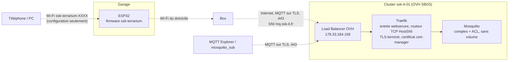

## Objectif

Le régulateur de la phase 1 est câblé, pas encore installé autour du bac. Une fois en place dans le garage, on ne le voit plus : savoir ce que vaut l'air du bac, ou passer de `ACTIF` à `HIBERNATION`, oblige à brancher un ordinateur sur sa liaison USB. Le propriétaire veut finir cela **avant** l'installation, pour ne plus avoir à rouvrir le boîtier.

Ce qu'on cherche à obtenir, avec son critère de réussite :

| # | Objectif | Critère de réussite |
| --- | --- | --- |
| W1 | Joindre le Wi-Fi du domicile sans recompiler ni brancher l'USB | Depuis un téléphone, on saisit les identifiants du Wi-Fi sur une page servie par le régulateur ; il s'y connecte et le garde après une coupure |
| W2 | Voir les mesures à distance | L'état du régulateur (mesures, chauffage, mode, consigne) arrive toutes les 30 s sur un courtier MQTT joignable depuis Internet |
| W3 | Changer le mode et la consigne à distance | Une commande MQTT change le mode ou la consigne du chauffage ; une valeur hors bornes est refusée et le refus se lit |
| W4 | Ne rien céder sur la sécurité | Ni la configuration, ni le courtier, ni une commande ne peuvent allumer une sortie, lever une protection ou fixer une consigne hors des bornes du firmware |

W4 prime sur les trois autres, comme O6 dans 2026-001.

### Ce que le référentiel disait déjà

- Ce cadrage s'empile sur [ssk-terrarium-cadrage#2026-001](https://ssk-canon.s3-website.fr-par.scw.cloud/ssk-it/ssk-terrarium-cadrage/cadrages/2026-001), dans sa variante sans limiteur (PR #21), qui n'est pas encore fusionné : ses règles n'existent que sur sa branche. Ce cadrage se fusionne après lui.
- **RG-regulation-sans-reseau** reste entière : le Wi-Fi, le portail, le courtier ne servent qu'à superviser.
- **RG-changement-de-mode-manuel** annonçait que MQTT s'ajouterait aux voies de commande : ce cadrage la modifie.
- **RG-mode-au-demarrage** disait que consignes et seuils restaient ceux du firmware « jusqu'à ce qu'ils deviennent réglables » : la consigne et l'hystérésis du chauffage le deviennent ici, et la règle est modifiée.
- La piste #13 proposait **RG-topics-mqtt** ; ce cadrage en retient une partie (voir « Hors périmètre »).
- La piste #12 laissait ouvert l'hébergement du courtier : ce cadrage le tranche (décision `03-hebergement-du-courtier`) et la réalise.
- La décision `05-firmware` de 2026-001 a écarté ESPHome pour ne pas dépendre de Home Assistant. Home Assistant n'est pas prévu ici non plus.
- Aucune règle ne bornait une consigne reçue par le réseau. Sans limiteur matériel en phase 1 (décision `06-protection-contre-la-surchauffe` de 2026-001), c'est le manque le plus grave que ce cadrage comble : **RG-reglages-bornes**.

### Ordre des phases

La feuille de route de 2026-001 plaçait la page web locale, les réglages et le NTP en phase 2, MQTT en phase 3. Ce cadrage avance une partie de la phase 3 — et des réglages de la phase 2 — avant le reste : décision `05-perimetre`.

## Parcours utilisateur

1. Premier démarrage, ou aucun Wi-Fi enregistré : le régulateur régule comme en phase 1 et ouvre son propre réseau, `ssk-terrarium-XXXX`. La liaison série affiche à chaque démarrage le nom de ce réseau et son mot de passe.
2. Depuis un téléphone, je rejoins ce réseau ; la page de configuration s'ouvre d'elle-même (sinon `http://192.168.4.1`). J'y choisis mon Wi-Fi, saisis son mot de passe, l'adresse du courtier, l'identifiant et le mot de passe MQTT du régulateur, et j'enregistre.
3. Le régulateur se connecte à mon Wi-Fi, ferme son réseau, puis joint le courtier en TLS. Toutes les 30 s, il publie son état.
4. Depuis mon ordinateur ou mon téléphone (MQTT Explorer, `mosquitto_sub`), je lis cet état sous `ssk-terrarium/<id>/state`.
5. Je publie `HIBERNATION` sur `cmd/mode` : le régulateur change de mode, l'enregistre, et le dit sur `event`. Je publie `{"consigne": 20}` sur `cmd/config` : il l'applique, l'enregistre, et le dit sur `event`.
6. Quand ça se passe mal :
   - La box tombe, le courtier redémarre, Internet est coupé : le chauffage continue comme si de rien n'était ; le régulateur se reconnecte seul, sans jamais faire attendre la régulation.
   - Le Wi-Fi enregistré reste injoignable 5 minutes (box changée, mot de passe changé) : le régulateur rouvre son réseau de configuration, tout en continuant d'essayer l'ancien.
   - Je publie `{"consigne": 30}` : la commande est refusée en entier, le refus et sa raison arrivent sur `event`, la consigne ne bouge pas.
   - Quelqu'un à portée du garage voit le réseau `ssk-terrarium-XXXX` : sans le mot de passe affiché sur la liaison série, il ne peut pas s'y connecter ; et même connecté, le portail ne commande aucune sortie.
   - L'image fusionnée efface la mémoire non volatile : après un téléversement, le régulateur repart en `MAINTENANCE` et sans Wi-Fi ; on refait l'étape 2.

## Exigences

- **F11** Configurer le Wi-Fi et le courtier sur place, par un réseau et une page servis par le régulateur. *(ce cadrage)*
- **F8** Publier l'état en MQTT et accepter des commandes — ici le mode, la consigne et l'hystérésis du chauffage ; le forçage temporaire reste à cadrer. *(ce cadrage, en partie)*
- **NF4** Persistance : la consigne et l'hystérésis du chauffage rejoignent le mode en mémoire non volatile. *(ce cadrage, en partie)*
- **NF7** Sobriété côté serveur : le courtier tient dans quelques dizaines de mégaoctets de mémoire et quelques millicœurs, sans volume. *(ce cadrage)*

## Architecture cible

Tout est en pointillé : rien de ce schéma n'entre dans la régulation.

## Hors périmètre

Restent à cadrer, chacun dans sa piste :

- `cmd/override`, le forçage temporaire d'une sortie, et les réglages de brumisation, d'éclairage et de ventilation par `cmd/config` (piste #13) ;
- la page web locale de supervision (piste #10) ; le portail de ce cadrage ne sert qu'à la configuration réseau ;
- les alertes ntfy (piste #14), l'OTA (piste #15), le NTP (piste #8), l'historique (piste #18).

## Questions ouvertes

- La chaîne du certificat que Traefik présentera : un certificat RSA de Let's Encrypt remonte aujourd'hui à ISRG Root X1, que le firmware embarque. Le vérifier sur le certificat réellement servi, et le consigner ici avant la fusion.

## Énoncés

### ADR-portail-wifi-maison

Le Wi-Fi et le courtier se configurent par un portail captif écrit dans le firmware : un point d'accès WPA2 propre au régulateur, une page servie par ESPAsyncWebServer, déjà retenu pour la page web locale, et le `DNSServer` du cœur Arduino. Aucune bibliothèque n'est ajoutée. Ce qui l'a décidé : WiFiManager ajoutait une bibliothèque et un second serveur web, synchrone, à côté de celui que la page web locale emploiera — décision `01-portail-de-configuration`.

### ADR-supervision-par-mqtt-tls

Le régulateur publie son état et reçoit ses commandes en MQTT, chiffré par TLS, avec PubSubClient et le `WiFiClientSecure` du cœur Arduino ; il vérifie le certificat du courtier contre la racine ISRG Root X1, embarquée dans le firmware. Ce qui l'a décidé : MQTT porte à la fois la publication et les commandes sur une connexion que le régulateur ouvre lui-même, sans service à écrire côté serveur, et le chiffrement est indispensable dès lors que le courtier est joint par Internet — décision `02-protocole-de-publication`.

### ADR-courtier-mosquitto-sur-ssk-it-01

Le courtier est un Mosquitto seul, déployé sur le cluster ssk-it-01 par le dépôt `ssk-it/ssk-it-infra`, sans volume ni historique. Il est joint à `mq.ssk-it.fr`, sur le port 443 : un routeur TCP du Traefik existant prend sur l'entrée `websecure` les connexions qui demandent ce nom dans leur poignée de main (SNI), y termine le TLS avec un certificat cert-manager, et passe le flux à Mosquitto. Aucun port n'est ajouté au Load Balancer. Ce qui l'a décidé : le cluster existe déjà, avec son entrée publique, ses certificats et ses secrets scellés, et Mosquitto y tient dans quelques mégaoctets ; une machine au domicile aurait été une infrastructure de plus à tenir — décision `03-hebergement-du-courtier`.

### RG-configuration-wifi-sur-place

Le régulateur ouvre son propre réseau Wi-Fi, `ssk-terrarium-` suivi des quatre derniers chiffres hexadécimaux de son adresse MAC, quand il n'a aucun Wi-Fi enregistré, ou quand le Wi-Fi enregistré reste injoignable 5 minutes ; il continue alors d'essayer ce dernier. Ce réseau est protégé en WPA2 par un mot de passe tiré au hasard au premier démarrage, enregistré en mémoire non volatile, et affiché sur la liaison série à chaque démarrage. Sa page de configuration demande le Wi-Fi du domicile, son mot de passe, l'adresse et le port du courtier, l'identifiant et le mot de passe MQTT du régulateur, et les enregistre en mémoire non volatile. Le réseau se ferme dès que le régulateur a rejoint le Wi-Fi du domicile. La commande série `WIFI CONFIGURER` le rouvre à la demande. La page ne commande aucune sortie et ne change ni le mode ni les réglages ; ni elle ni la connexion n'interrompent la régulation, qui n'attend jamais le réseau. Aucun identifiant ne figure dans le dépôt ni dans l'image du firmware. Ce que la règle protège : on configure le réseau sans outil ni recompilation, sans qu'un voisin puisse le faire, et sans que cette configuration puisse rien allumer.

### RG-topics-mqtt

Le régulateur publie et reçoit sous le préfixe `ssk-terrarium/<id>/`, où `<id>` est l'adresse MAC du régulateur en hexadécimal, affichée sur la liaison série :

| Sujet | Sens | Contenu |
| --- | --- | --- |
| `state` | publié, retenu, toutes les 30 s | JSON : mesures de l'air et du substrat (`null` si invalides), état de chaque sortie, mode, consigne, hystérésis, défaut capteur, temps depuis le démarrage, version du firmware |
| `event` | publié | JSON : changement de mode, réglage accepté ou refusé avec sa raison, démarrage |
| `status` | publié, retenu | `en-ligne` à la connexion, `hors-ligne` comme dernière volonté |
| `cmd/mode` | reçu | `ACTIF`, `HIBERNATION` ou `MAINTENANCE` |
| `cmd/config` | reçu | JSON partiel : `consigne`, `hysteresis` (°C) |

Une commande retenue par le courtier n'est jamais appliquée : seule compte une commande publiée pendant que le régulateur est connecté. Le courtier remet les messages retenus juste après l'abonnement, et la bibliothèque PubSubClient ne dit pas si un message l'est : toute commande reçue dans les 3 secondes qui suivent l'abonnement est donc ignorée, et l'ignorance signalée sur `event`. Toute commande reçoit sa réponse sur `event`. Ce que la règle protège : on lit l'état sans attendre la mesure suivante, et une commande ancienne, oubliée sur le courtier, ne change pas le mode à la reconnexion suivante.

### RG-courtier-authentifie

Le courtier n'accepte que des connexions chiffrées par TLS et authentifiées par un compte. Le compte du régulateur ne peut publier que sur `state`, `event` et `status` de son préfixe, et ne lire que ses `cmd/#`. Le compte du propriétaire peut lire tout `ssk-terrarium/#` et publier sur les `cmd/#`. Aucun compte anonyme. Les mots de passe n'existent que scellés dans `ssk-it-infra` et enregistrés dans le régulateur. Ce que la règle protège : le courtier est joignable depuis Internet ; sans compte, personne ne lit ni ne commande le régulateur, et le régulateur lui-même ne peut pas se donner d'ordre.

### RG-reglages-bornes

La consigne et l'hystérésis du chauffage en mode `ACTIF` sont réglables à distance, dans des bornes fixées à la compilation, qu'aucune commande ni aucun réglage enregistré ne peut changer : consigne de 15 à 22 °C, hystérésis de 0,2 à 2 °C, et consigne plus hystérésis strictement sous 24 °C, le seuil d'alerte haute. Une commande dont une valeur sort de ces bornes, ou qui est mal formée, est refusée en entier, et rien n'en est appliqué. Un réglage accepté s'applique à la mesure suivante et s'enregistre en mémoire non volatile. Le hors-gel de `HIBERNATION` (4-6 °C), la durée maximale de chauffe continue, la coupure sur capteur en défaut et le chien de garde ne sont pas des réglages : aucune commande ne les modifie. Ce que la règle protège : sans limiteur matériel en phase 1, une erreur de saisie ou un compte compromis ne peut pas porter l'air du bac au-delà de 24 °C par la consigne.

### RG-changement-de-mode-manuel

On passe d'un mode à l'autre seulement par une commande explicite, reçue par la liaison série USB ou par MQTT (`cmd/mode`) ; la page web locale s'y ajoutera avec sa phase. Le régulateur ne change jamais de mode de lui-même, ni selon la date, ni selon une mesure, ni à la perte ou au retour du réseau. Ce que la règle protège : aucun réveil intempestif d'un élevage en hibernation.

### RG-mode-au-demarrage

Le mode en cours, la consigne et l'hystérésis du chauffage sont enregistrés en mémoire non volatile à chaque changement. Au démarrage, le régulateur reprend le mode enregistré ; s'il n'en trouve aucun de valide — premier démarrage, mémoire effacée ou corrompue —, il démarre en `MAINTENANCE`, tout coupé, jusqu'à ce qu'on choisisse un mode. Il reprend la consigne et l'hystérésis enregistrées si elles respectent RG-reglages-bornes, et sinon celles du firmware. Les autres seuils restent ceux du firmware jusqu'à ce qu'ils deviennent réglables. Ce que la règle protège : une coupure de courant en plein hiver ne fait pas sortir l'élevage de son hors-gel, un régulateur qui ne sait pas où il en est ne chauffe pas au hasard, et un réglage enregistré par un firmware plus ancien, aux bornes plus larges, n'échappe pas aux bornes du firmware courant.
